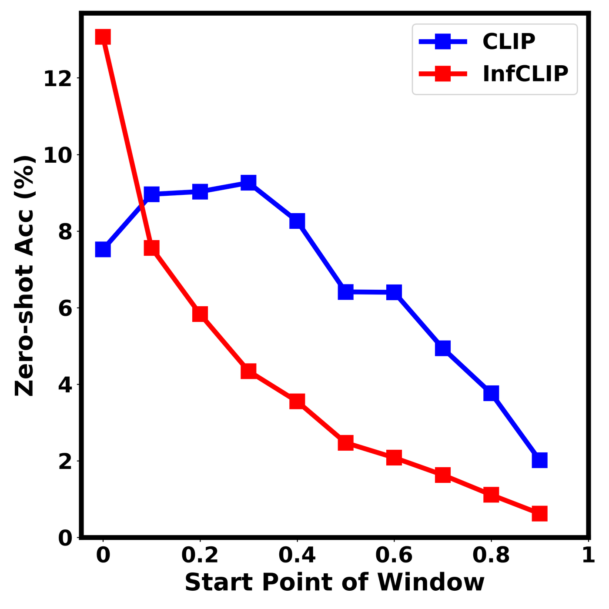

# InfCLIP: Unified Data Valuation for CLIP Pretraining via Influence-Inspired Scoring

**Nohyun Ki, Hye Won Chung** · KAIST · **NeurIPS 2026**

[[Project page]](https://GITHUB_USER.github.io/InfCLIP/) · [[Paper]](PAPER_URL) · [[OpenReview]](OPENREVIEW_URL)

<p align="center">
  
</p>

InfCLIP scores each image-text pair by how strongly it interacts with a target task, using only
features from a pretrained CLIP teacher and temperature-rescaled softmax distributions. No
retraining, gradients, or model internals are needed. Alignment, target relevance, and sample
uniqueness all appear inside one score, and selecting the top-scoring 30-40% of CC3M or 10-20% of
CC12M already beats training on the full dataset.

This repository reproduces the main subset-selection pipeline:

1. Extract CC3M / CC12M features and ImageNet class prototypes with an OpenCLIP teacher.
2. Compute InfCLIP scores.
3. Train CLIP from scratch on the top-scoring subset and evaluate ImageNet zero-shot accuracy.

## Installation

```bash
conda create -n infclip python=3.10 -y
conda activate infclip
# Install PyTorch for your CUDA version first: https://pytorch.org/get-started/locally/
pip install -r requirements.txt
```

## Quick start: score your own data

If you already have L2-normalizable image/text features of a training set and a target set from
the same CLIP teacher, scoring is a single call:

```python
import torch
from calculate_score import calculate_inf_softmax_ntk

train = {"image_outputs": train_img_feats, "text_outputs": train_txt_feats}     # (N, D) each
target = {"image_outputs": target_img_feats, "text_outputs": target_txt_feats}  # (M, D) each

scores = calculate_inf_softmax_ntk(train, target, batch_size=1024, logit_scale=10,
                                   device=torch.device("cuda"))
keep = scores.argsort()[::-1][: int(0.3 * len(scores))]   # top 30%
```

Scoring CC3M takes under a minute on one RTX A6000 once features are extracted.

## Reproducing the paper

### 1. Data

We do not redistribute CC3M, CC12M, or ImageNet. Download them from the original sources and
follow their licenses and terms of use.

CC3M and CC12M are read as Hugging Face Arrow shards. `prepare_data.py` downloads a Hub copy
and links the shards under the names the code expects:

```bash
python prepare_data.py --dataset_name cc3m  --hf_repo HF_REPO_CC3M  --cache_dir $HF_CACHE --output_dir $CC3M_ROOT
python prepare_data.py --dataset_name cc12m --hf_repo HF_REPO_CC12M --cache_dir $HF_CACHE --output_dir $CC12M_ROOT
```

| Dataset | Expected files |
| --- | --- |
| CC3M | `cc3m-wds-train-00000-of-00521.arrow` ... `-00520-of-00521.arrow` |
| CC12M | `webdataset-train-00000-of-02224.arrow` ... `-02223-of-02224.arrow` |

Scores are indexed by sample position in the concatenated shards, so keep the shard order.

ImageNet validation must be in ImageFolder layout with WordNet-ID folders (`n01440764/`, ...).

```bash
export CC3M_ROOT=/path/to/cc3m_arrow
export CC12M_ROOT=/path/to/cc12m_arrow
export IMAGENET_VAL=/path/to/imagenet/val
```

### 2. Features and InfCLIP scores

Teacher: OpenCLIP `ViT-B-32`, `pretrained="datacomp_xl_s13b_b90k"`.

```bash
DATASET=cc3m  DATA_ROOT=$CC3M_ROOT  bash scripts/compute_scores.sh
DATASET=cc12m DATA_ROOT=$CC12M_ROOT bash scripts/compute_scores.sh
```

This runs, in order:

| Step | Script | Output |
| --- | --- | --- |
| Train features | `extract_feature.py` | `outputs/features/{cc3m,cc12m}_image_text_features.pt` |
| ImageNet prototypes (1000 class-mean image features, 80-template text features) | `extract_target_feature.py` | `outputs/features/imagenet_classmean_features.pt` |
| InfCLIP scores (logit scale 10, batch 1024) | `calculate.py` | `outputs/scores/{cc3m,cc12m}_infclip_l10_B1024_classmean.npy` |

### 3. Subset training and ImageNet zero-shot evaluation

`subset_run.py` selects the top-scoring subset, trains CLIP from scratch, saves the checkpoint,
and appends ImageNet top-1 / top-5 accuracy to a result file. Single run (top 30% of CC3M):

```bash
CUDA_VISIBLE_DEVICES=0,1,2,3 python subset_run.py \
  --dataset_name cc3m --data_root $CC3M_ROOT \
  --score_name InfCLIP --score_path outputs/scores/cc3m_infclip_l10_B1024_classmean.npy \
  --subset_ratio 0.3 --seed 1 --num_train_epochs 10 \
  --per_gpu_train_batch_size 256 \
  --imagenet_val $IMAGENET_VAL \
  --output_dir outputs/saved_model --result_path outputs/results/cc3m_imagenet.txt
```

All ratios and three seeds:

```bash
DATASET=cc3m  DATA_ROOT=$CC3M_ROOT  bash scripts/train_subsets.sh
DATASET=cc12m DATA_ROOT=$CC12M_ROOT bash scripts/train_subsets.sh
```

Evaluate a saved checkpoint separately:

```bash
python zeroshot_eval.py --checkpoint_path outputs/saved_model/cc3m_InfCLIP_0.3_seed1.pth --data_dir $IMAGENET_VAL
```

Other options of `subset_run.py`: `--score_name random` for random subsets,
`--subset_path` to train on a saved index file, and `--score_order asc` to keep the
lowest-scoring samples (e.g. the reverse-pruning experiment keeps the bottom `1 - r`).

### Training setup

| Setting | Value |
| --- | --- |
| Model | OpenAI CLIP-style modified ResNet-50 + Transformer text encoder (width 512, 8 heads, 6 layers), embedding dim 512, 224px input |
| Optimizer | AdamW, lr 5e-4, weight decay 0.1, eps 1e-8 |
| Schedule | linear warmup for 20% of steps, then cosine decay |
| Global batch size | 1024 (256 per GPU x 4 GPUs) |
| Budget | 10 full-data epochs (CC3M), 5 (CC12M); a subset of ratio r is trained ~1/r times as many epochs, so total steps are equal |
| Preprocessing | resize + center crop, no augmentation |
| Temperature | learnable, initialized to 0.07, logit scale capped at 100 |

The global batch size is per-GPU batch x number of visible GPUs; `subset_run.py` warns if it is
not 1024.

## Repository structure

```text
calculate_score.py        InfCLIP score (Eq. 2 / Algorithm 1)
calculate.py              CLI: features -> scores (.npy)
extract_feature.py        teacher features for CC3M / CC12M
extract_target_feature.py ImageNet class-mean prototypes
prepare_data.py           Hub download -> named Arrow shards
subset_run.py             subset selection + CLIP training + ImageNet eval
zeroshot_eval.py          ImageNet zero-shot evaluation
dataloader/  model/  trainer/  utils/  zero_shot/  data/
scripts/                  end-to-end shell scripts
docs/                     project page (GitHub Pages)
```

## Citation

```bibtex
@inproceedings{ki2026infclip,
  title     = {InfCLIP: Unified Data Valuation for CLIP Pretraining via Influence-Inspired Scoring},
  author    = {Ki, Nohyun and Chung, Hye Won},
  booktitle = {Advances in Neural Information Processing Systems},
  year      = {2026}
}
```

## Acknowledgments

This work was supported by the National Research Foundation of Korea (NRF) grant funded by the
Korea government (MSIT) (No. RS-2024-00408003 and RS-2025-00516153) and the Institute for
Information & communications Technology Planning & Evaluation (IITP) grant funded by the Korea
government (MSIT) (No. RS-2024-00444862 and RS-2026-25522672).

Model and tokenizer code is adapted from [OpenAI CLIP](https://github.com/openai/CLIP).
See [THIRD_PARTY_NOTICES.md](THIRD_PARTY_NOTICES.md).

## License

Code is released under the [MIT License](LICENSE).
